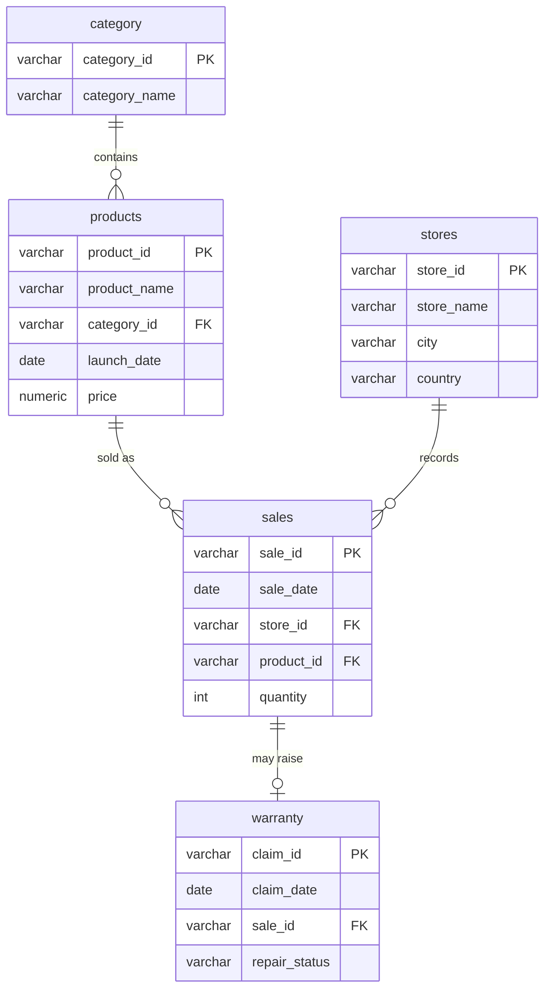

# Apple Retail Sales SQL Project: Analysing 1M+ Sales Rows

An end-to-end SQL analytics project on a **1,040,200-row retail sales dataset** covering products, stores, transactions, categories and warranty claims. It answers 20 business questions, from simple counts to window-function analysis, in PostgreSQL.

> **Synthetic data.** The schema mirrors the public Kaggle *Apple Retail Sales* dataset. The data is generated, not real Apple Inc. figures, and is for educational and portfolio use only.

---

## Quick start

```bash
python -m venv .venv && source .venv/bin/activate
pip install -r requirements.txt

python data/generate.py     # writes data/raw/*.csv (about 4 seconds, seeded, same data every run)
python run_analysis.py      # runs all 20 questions and writes results/results.md
```

`run_analysis.py` uses [DuckDB](https://duckdb.org), so no database server is needed. The SQL is plain PostgreSQL and DuckDB runs it unchanged.

**On PostgreSQL:**

```bash
createdb apple_retail
psql -d apple_retail -f sql/01_schema.sql -f sql/02_load.sql -f sql/03_indexes.sql
psql -d apple_retail -f sql/04_analysis.sql
```

**Using the Kaggle CSVs instead:** download them into `data/raw/` (same five file names) and skip `generate.py`.

---

## Dataset

| Table | Rows | Columns |
|---|---|---|
| `category` | 10 | category_id, category_name |
| `products` | 58 | product_id, product_name, category_id, launch_date, price |
| `stores` | 43 | store_id, store_name, city, country |
| `sales` | 1,040,200 | sale_id, sale_date, store_id, product_id, quantity |
| `warranty` | 28,094 | claim_id, claim_date, sale_id, repair_status |

Sales run from **January 2020 to December 2024** across 43 stores in 18 countries. The generator builds in realistic patterns, such as holiday peaks, launch spikes, flagship stores and products that fail more often, so the queries have something to find.



---

## Business questions

All 20 are in [`sql/04_analysis.sql`](sql/04_analysis.sql), with full answers in [`results/results.md`](results/results.md).

| # | Question | SQL used |
|---|---|---|
| **Foundations** | | |
| Q01 | Stores per country | `GROUP BY` |
| Q02 | Top 10 stores by units sold | joins, `LIMIT` |
| Q03 | Sales in December 2023 | date ranges |
| Q04 | Share of claims marked "Warranty Void" | `FILTER` |
| Q05 | Average price per category | aggregates |
| **Sales performance** | | |
| Q06 | Revenue and share of total by category | window over aggregate |
| Q07 | Quarterly revenue trend | `EXTRACT` |
| Q08 | Each store's best day of the week | `RANK()` |
| Q09 | Least-selling product per country in 2024 | `RANK()` per partition |
| Q10 | US months above 9,000 units (last 3 years) | `HAVING`, intervals |
| Q11 | Sales across the product lifecycle | `CASE` on launch age |
| **Warranty & risk** | | |
| Q12 | Products with the highest claim rates | `LEFT JOIN` rates |
| Q13 | Do premium products fail more? | price bands |
| Q14 | Claims within 180 days, median days to claim | `PERCENTILE_CONT` |
| Q15 | Category with most claims (last 2 years) | intervals |
| Q16 | Chance a sale becomes a claim, by country | `LEFT JOIN` rates |
| Q17 | Stores with no claims (data-quality check) | `NOT EXISTS` |
| **Advanced** | | |
| Q18 | Fastest-growing stores year over year | `LAG()` |
| Q19 | Top 3 products per category | `DENSE_RANK()` |
| Q20 | Rolling 3-month revenue, month-over-month change | frames, `LAG()` |

---

## Key findings

*From the synthetic dataset.*

- **Smartphones and laptops drive 70% of revenue:** smartphones 40.1% ($869M) and laptops 29.7% ($644M). Accessories are the second-best-selling category by units (584K) but bring in only 1.5% of revenue.
- **December is the peak month:** in 2024, December revenue ($83.2M) was 46% above November and about double a typical month. August–September show a smaller back-to-school lift.
- **Audio is the riskiest category per sale:** AirPods Max (5.3%) and AirPods Pro (5.0%) have the highest claim rates, ahead of every iPhone. Audio ranks second for total claims despite being only 4.3% of revenue.
- **Cheap items rarely come back:** products under $200 have a 1.8% claim rate, versus about 3.1% for everything above $200. Above that point, price makes little difference.
- **Half of all claims arrive within six months:** 53% are filed within 180 days of purchase (median 170 days), which matters for warranty reserves and support staffing.
- **New products earn more per sale:** average revenue per transaction holds at about $2,400 for the first 18 months, then drops 15% as models age.
- **One in five claims is voided:** 19.9% of claims end as "Warranty Void", a candidate for clearer customer guidance at the point of sale.

---

## Performance

`sql/03_indexes.sql` adds indexes on the columns these queries filter and join on (`product_id`, `store_id + sale_date`, `sale_date`, `warranty.sale_id`). On PostgreSQL, compare `EXPLAIN ANALYZE` before and after: product and store lookups go from a sequential scan of ~1M rows to an index scan.

With DuckDB (columnar, in-memory), each of the 20 queries runs in under 50 ms on a laptop.

---

## Project structure

```
├── data/
│   ├── generate.py         # seeded synthetic data generator (1,040,200 sales rows)
│   └── raw/                # CSVs (git-ignored, recreate with generate.py)
├── sql/
│   ├── 01_schema.sql       # tables, keys, constraints
│   ├── 02_load.sql         # \copy loaders for psql
│   ├── 03_indexes.sql      # indexes + EXPLAIN notes
│   └── 04_analysis.sql     # the 20 business questions
├── results/results.md      # every answer, generated
├── run_analysis.py         # runs the SQL with DuckDB
└── requirements.txt
```

## Tech stack

PostgreSQL · SQL (CTEs, window functions, `FILTER`, `PERCENTILE_CONT`) · DuckDB · Python · pandas · NumPy
